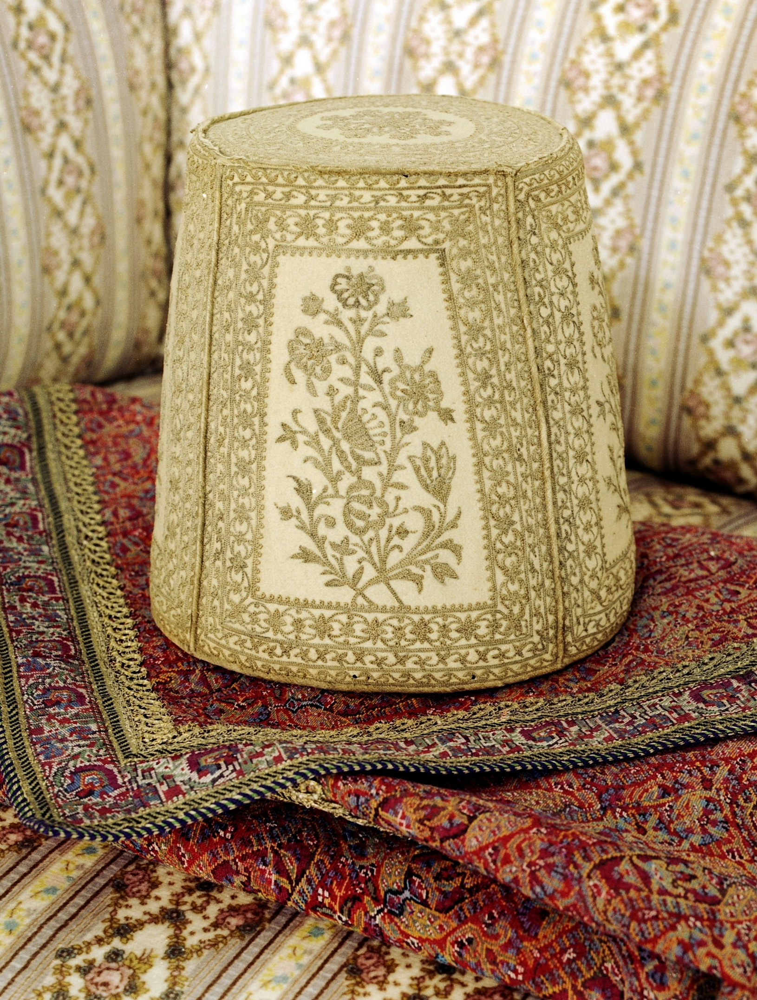

<!--
Archived from slides/week-06.qmd on 13 October 2026: slides 9-15 ("He hath known
God who hath known himself" through the two Story Corner slides on Hamzih and
Abu-Jahl), and the twofold-station note that closed the "Sanctified Mirrors" slide.
To restore, paste a slide back above the finale, with a --- separator.
-->

## Twofold station note (from the foot of "Sanctified Mirrors")

::: {.fs-body .fragment .observation-close}
"There is no distinction whatsoever between Thee and them; except that they are Thy servants" —
and yet, "I am He, Himself, and He is I, myself" (¶106). Bahá'u'lláh returns to this in ¶161,
where He speaks of the "twofold station" of the Manifestations.
:::

---

## He hath known God who hath known himself

::: {.slide-sub}
Bahá'u'lláh
:::

::: {.figure-slide}
::: {.fs-body .fs-md}
::: {.fragment}
How resplendent the luminaries of knowledge that shine in an atom, and how vast the oceans of
wisdom that surge within a drop! To a supreme degree is this true of man, who, among all created
things, hath been invested with the robe of such gifts, and hath been singled out for the glory of
such distinction. For in him are potentially revealed all the attributes and names of God to a
degree that no other created being hath excelled or surpassed.

[Kitáb-i-Íqán ¶107]{.poem-attrib .proof-attrib}
:::

::: {.fragment .proof-next}
Regard man as a mine rich in gems of inestimable value. Education can, alone, cause it to reveal
its treasures, and enable mankind to benefit therefrom.

[*Gleanings from the Writings of Bahá'u'lláh*, CXXII]{.poem-attrib .proof-attrib}
:::
:::

::: {.fs-portrait}

:::
:::

---

## The Meaning of Sovereignty

::: {.tiles .two}
::: {.tile .fragment}
[What the people expected]{.tile-name}
[Paragraph 113]{.tile-epithet}

- The traditions promised the Qá'im **sovereignty**
- Yet the Báb was imprisoned and put to death
- His followers "afflicted of men", "the victims of the fierce opposition of their enemies"
- "Are they not today leading the life of abased and impotent mortals?"
:::

::: {.tile .marked .fragment}
[What it is]{.tile-name}
[Paragraphs 114, 117]{.tile-epithet}

- "The spiritual ascendancy which He exerciseth to the fullest degree over all that is in heaven
  and on earth"
- Revealed "in direct proportion to its capacity and spiritual receptiveness"
- Earthly sovereignty follows, "either in the lifetime of every Manifestation of God or after His
  ascension"
:::
:::

::: {.fs-body .fragment .observation-close}
"Hath not the same befallen this Servant, and been witnessed by all?" (¶114). Bahá'u'lláh is
writing in Baghdad in 1862, an exile, a year before He declares His mission in the Garden of
Riḍván.
:::

---

## A Ladder into Heaven

::: {.slide-sub}
Bahá'u'lláh
:::

::: {.figure-slide}
::: {.fs-body .fs-md}
::: {.fragment}
That verse was revealed at a time when Muḥammad languished weary and sorrowful beneath the weight
of the opposition of the people, and of their unceasing torture. In the midst of His agony, the
Voice of Gabriel, calling from the Sadratu'l-Muntahá, was heard saying: "But if their opposition
be grievous to Thee—if Thou canst, seek out an opening into the earth or a ladder into heaven."

[Kitáb-i-Íqán ¶116]{.poem-attrib .proof-attrib}
:::

::: {.fragment .proof-next}
Consider, how great is the change today! Behold, how many are the Sovereigns who bow the knee
before His name! How numerous the nations and kingdoms who have sought the shelter of His shadow,
who bear allegiance to His Faith, and pride themselves therein!

[Kitáb-i-Íqán ¶117]{.poem-attrib .proof-attrib}
:::
:::

::: {.fs-portrait}

:::
:::

---

## The Sword and the Bond

::: {.slide-sub}
Bahá'u'lláh
:::

::: {.figure-slide}
::: {.fs-body .fs-tight}
::: {.fragment}
Hast thou not heard how with one single verse He hath sundered light from darkness, the righteous
from the ungodly, and the believing from the infidel? … So mercilessly trenchant was this wondrous
sword of God that it cleft asunder every relationship!
:::

::: {.fragment}
On the other hand, consider the welding power of His Word. Observe, how those in whose midst the
Satan of self had for years sown the seeds of malice and hate became so fused and blended through
their allegiance to this wondrous and transcendent Revelation that it seemed as if they had sprung
from the same loins.

[Kitáb-i-Íqán ¶118]{.poem-attrib .proof-attrib}
:::

::: {.fragment .proof-next}
This is the significance of the well-known words: "The wolf and the lamb shall feed together." …
Besides, of what profit would it be to the world were such a thing to take place?

[Kitáb-i-Íqán ¶119]{.poem-attrib .proof-attrib}
:::
:::

::: {.fs-portrait}

:::
:::

---

## Ye must be born again

::: {.tiles}
::: {.tile .marked .fragment}
[Trumpet]{.tile-name}
[Paragraphs 122–123]{.tile-epithet}

- Not the Seraph's horn, "who is but one of His servants"
- "The trumpet-call of Muḥammad's Revelation, which was sounded in the heart of the universe"
:::

::: {.tile .marked .fragment}
[Resurrection]{.tile-name}
[Paragraphs 123, 125]{.tile-epithet}

- "His own rise to proclaim the Cause of God"
- He bade the wayward "speed out of the sepulchers of their bodies"
- "Whosoever in every dispensation is born of the Spirit"
:::

::: {.tile .marked .fragment}
[Life and death]{.tile-name}
[Paragraphs 120, 127–128]{.tile-epithet}

- "The life of faith and the death of unbelief"
- "Let the dead bury their dead"
- "A dead man hath bought from another dead man a house"
:::
:::

::: {.fragment .poem}
> Wert thou to attain to but a dewdrop of the crystal waters of divine knowledge, thou wouldst
> readily realize that true life is not the life of the flesh but the life of the spirit.

[Kitáb-i-Íqán ¶128]{.poem-attrib}
:::

---

## Story Corner

::: {.slide-sub}
Ḥamzih and Abú-Jahl
:::

::: {.tiles .two}
::: {.tile .marked .fragment}
[Ḥamzih]{.tile-name}
[The "Prince of Martyrs"]{.tile-epithet}

- An uncle of Muḥammad, close to Him in age
- Known in Mecca as a hunter and a fearless fighter
- Slow to take sides as the young Faith was being persecuted
:::

::: {.tile .fragment}
[Abú-Jahl]{.tile-name}
[The "Father of Ignorance"]{.tile-epithet}

- ʻAmr ibn Hishám, one of the leading men of the Quraysh
- Known to his people as **Abu'l-Ḥakam**, "Father of Wisdom"
- The Muslims came to call him **Abú-Jahl**, "Father of Ignorance"
- One of Muḥammad's fiercest opponents
:::
:::

::: {.fs-body .fragment .observation-close}
Remember the two kinds of knowledge from last week: one yields "true understanding, and love", the
other "arrogance, vainglory and conceit" (¶76).
:::

---

## Story Corner

::: {.slide-sub}
Ḥamzih and Abú-Jahl
:::

::: {.fs-body .fs-narrow .incremental}
- One day Abú-Jahl came upon Muḥammad near the hill of Ṣafá and heaped abuse on Him. Muḥammad
  made no reply
- Ḥamzih was returning from a hunt, his bow on his shoulder, when he was told what had happened
- He went straight to the Kaʻbah, where Abú-Jahl was sitting with his companions, and struck him
  with his bow: "Will you insult him, when I follow his religion?"
- That day Ḥamzih declared his faith
- Then came the verse: "Shall the dead, whom We have quickened, and for whom We have ordained a
  light whereby he may walk among men, be like him, whose likeness is in the darkness, whence he will not come forth?" (¶129)
- The people "loudly clamored: 'When did Ḥamzih die? When was he risen?'"
- Abú-Jahl was killed at the Battle of Badr in 624; Ḥamzih fell at Uḥud a year later, and
  Muḥammad named him the Prince of Martyrs
- "He who is a true believer liveth both in this world and in the world to come" (¶128)
:::

::: {.tiny}
The account of Ḥamzih's conversion is from Ibn Isḥáq, *Sírat Rasúl Alláh*.
:::
