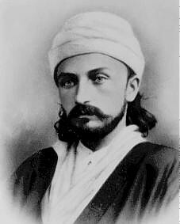
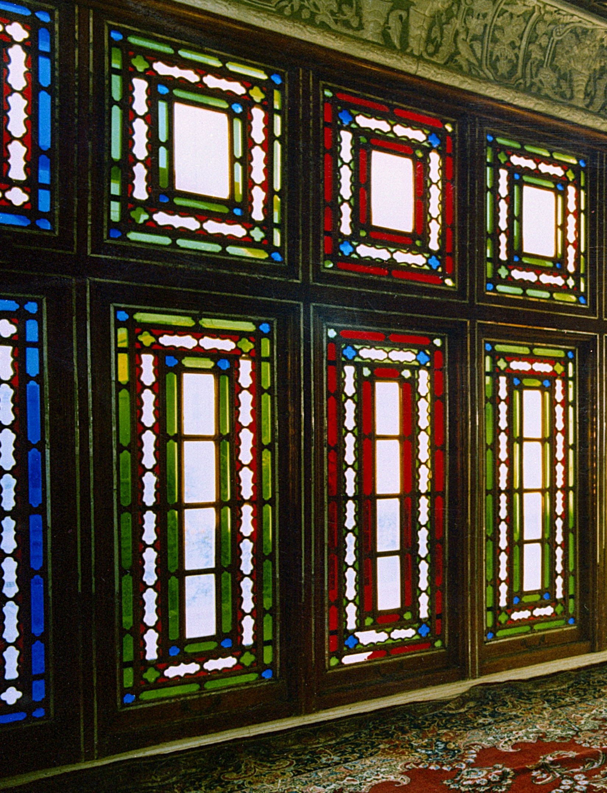

##  {.divider}

::: {.kicker}
Week 6
:::
::: {.divider-title}
Part Two
:::
::: {.divider-sub}
Paragraphs 102–130
:::

---

## Turn to your neighbour

::: {.incremental .fill}
- With the person next to you try to remember what you read this week
- What did Bahá'u'lláh say in these paragraphs?
- What ideas stood out to you?
- Which parts did you not understand?
- What questions came up as you were reading?
:::

---

## Shoghi Effendi's Overview

::: {.tight .overview .fragment}
- **Proclaims the existence and oneness of a personal God, unknowable, inaccessible, the source of
  all Revelation, eternal, omniscient, omnipresent and almighty**
- Asserts the relativity of religious truth and the continuity of Divine Revelation
- **Affirms the unity of the Prophets, the universality of their Message, the identity of their
  fundamental teachings, the sanctity of their scriptures, and the twofold character of their stations**
- **Denounces the blindness and perversity of the divines and doctors of every age**
- Cites and elucidates the allegorical passages of the New Testament, the abstruse verses of the
  Qur'án, and the cryptic Muḥammadan traditions which have bred those age-long misunderstandings, doubts and animosities that have sundered and kept apart the followers of the world’s leading religious systems
- Enumerates the essential prerequisites for the attainment by every true seeker of the object
  of his quest
- Demonstrates the validity, the sublimity and significance of the Báb's Revelation
- **Unfolds the meaning of such symbolic terms as "Return," "Resurrection," "Seal of the Prophets"
  and "Day of Judgment"**
- **Distinguishes between the three stages of Divine Revelation**
- Expatiates upon the glories and wonders of the "City of God"
:::

::: {.tiny}
Shoghi Effendi, *God Passes By* — the five in bold are where this week's reading takes us.
:::

---

## Two themes this week

::: {.tiles .two .fill}
::: {.tile .marked}
[Three Stages of Divine Revelation]{.tile-name}
[Paragraphs 102–117]{.tile-epithet}

- God, the **unknowable Essence**: "No vision taketh in Him, but He taketh in all vision"
- The Manifestations as **sanctified Mirrors**, His Exponents on earth
- Every created thing reflects His names and attributes, and **man** most of all
- All the Prophets bear all His attributes, differing only in **intensity**
- Sovereignty is **spiritual ascendancy**, "though no man be found on earth to obey Him"
:::

::: {.tile .marked}
[Life, Death and Resurrection]{.tile-name}
[Paragraphs 118–130]{.tile-epithet}

- One verse of Muḥammad **sundered** light from darkness, and **welded** hearts together
- **The wolf and the lamb**: peoples of conflicting creeds made one
- **Trumpet**: the call of His Revelation; **resurrection**: His rise to proclaim it
- **Life and death**: "the life of faith and the death of unbelief"
- "Ye must be born again"; "Let the dead bury their dead"
:::
:::

---

## This week's paragraphs

::: {.tiles .two .outline}
::: {.tile}
- Sovereignty of the Manifestations — ¶102–3
- God as unknowable Essence, and His Manifestations — ¶104–10
  - The Manifestations as mirrors and exponents of God — ¶106
  - All things, and man above all, reveal His names and attributes — ¶107–9
  - All Prophets hold every attribute, differing in intensity — ¶110
- People neglect the inner meaning of God's words — ¶111–12
- Why the sovereignty of the Qá'im has not appeared — ¶113–17
  - Sovereignty as spiritual ascendancy — ¶114
:::

::: {.tile}
- The power of one verse of Muḥammad — ¶118–20
  - "The wolf and the lamb shall feed together" — ¶119
  - Reckoning, and the meaning of "life" and "death" — ¶120
- Resurrection and judgment in Muḥammad's Revelation — ¶121–30
  - Meaning of "trumpet" and "resurrection" — ¶123
  - "Ye must be born again" — ¶125
  - "Let the dead bury their dead" — ¶126
  - ʻAlí and the contract between two dead men — ¶127
  - Ḥamzih and Abú-Jahl — ¶129
:::
:::

---

## Three Stages of Revelation

::: {.tiles .fill}
::: {.tile .fragment}
[God]{.tile-name}
[Paragraphs 104–105]{.tile-epithet}

- "Veiled in the ancient eternity of His Essence"
- "No tie of direct intercourse can possibly bind Him to His creatures"
:::

::: {.tile .marked .fragment}
[The Manifestations]{.tile-name}
[Paragraphs 106, 109–110]{.tile-epithet}

- "These sanctified Mirrors … are one and all the Exponents on earth of Him"
- "The beauty of their countenance is but a reflection of His image"
- All bear every attribute; they differ only in "the intensity of their revelation"
:::

::: {.tile .fragment}
[Creation]{.tile-name}
[Paragraphs 107, 109]{.tile-epithet}

- "Within every atom are enshrined the signs" of that Light
- "Each according to its capacity"
- In man "are potentially revealed all the attributes and names of God"
:::
:::

---

## Three Stages of Revelation

::: {.slide-sub}
ʻAbdu'l-Bahá
:::

::: {.figure-slide}
::: {.fs-body .fs-prose .fill}
::: {.fragment}
Know also that the three horizontal lines represent the World of God, the World of Command, and
the World of Creation, for they are the sources of the [divine] influences. The World of God is the
source of the grace of the Almighty; the World of Command is the pure and refined mirror in which
the Sun of Reality is manifested; and the World of Creation is the source of the acquisition of
effulgences which appear through the medium of the Most Great Channel, that is, the recipient of
the grace of God and the bestower of grace upon created things.
:::

::: {.fragment}
Since the true bá, which is the universal reality, passes down through the three grades from the
highest summit to the lowest centre and shines forth in each grade, it is the unifier and revealer
of all the worlds. On the horizon of ancient grandeur, two brilliant stars are shining and
luminous: one star is on the right, the other on the left. And this great mystery is the two
shapes that have been drawn upon the left and right of the Greatest Name on the ringstone symbol.
The mystery concerns the manifestation of Bahá'u'lláh and the Báb. Although the two shapes on
right and left are in the form of a star, they refer nevertheless to the Temple of Man, which
consists of a head and arms and two legs.
:::

::: {.tiny}
ʻAbdu'l-Bahá, Tablet on the Greatest Name, trans. Denis MacEoin, *Rituals in Babism and Bahá'ísm*
(1994), pp. 143–144.
:::
:::

::: {.fs-portrait}
{fig-alt="The ringstone symbol: three horizontal lines joined by a vertical stroke, in stylized Arabic calligraphy, with a five-pointed star on either side."}
:::
:::

---

## The Unknowable Essence

::: {.slide-sub}
ʻAbdu'l-Bahá
:::

::: {.figure-slide}
::: {.fs-body .fs-prose .fill}
::: {.fragment}
Yet we ascribe certain names and attributes to the reality of the Divinity and praise Him for His
sight, His hearing, His power, His life and knowledge. We affirm these names and attributes not to
affirm the perfections of God, but to deny that He has any imperfections.
:::

::: {.fragment}
When we observe the contingent world, we see that ignorance is imperfection and knowledge is
perfection, and thus we say that the sanctified Essence of the Divinity is all-knowing. Weakness is
imperfection and power is perfection, and thus we say that that sanctified and divine Essence is
all-powerful. It is not that we can understand His knowledge, His sight, His hearing, His power, or
His life as they are in themselves: This is assuredly beyond our comprehension, for the essential
names and attributes of God are identical with His Essence, and His Essence is sanctified above all
understanding.
:::

::: {.fragment}
It follows that all these names, attributes, laudations, and praises apply to the Manifestations of
God Themselves, and that all that we may construe or conceive besides them is sheer delusion, for
we can never find a path to the Invisible and Inaccessible. Thus it is said: "All that ye vainly
believe to have discerned and expressed in your subtlest terms is but a creature like unto you and
returneth unto your own selves."
:::

::: {.tiny}
ʻAbdu'l-Bahá, *Some Answered Questions*, ch. 37.
:::
:::

::: {.fs-portrait}

:::
:::

---

## The Unknowable Essence

::: {.slide-sub}
ʻAbdu'l-Bahá
:::

::: {.figure-slide}
::: {.fs-body .fs-prose .fill .fill-lg}
::: {.fragment}
*Question: Why is the expression "He is God" used at the beginning of the Tablets and Epistles?*
:::

::: {.fragment}
Answer: This is a common practice in the East among the Muslims, and their intent is that one must
begin all things with the mention of God. But what is intended in the divine Tablets is that the
reality of the divine Essence is sanctified above all understanding, exalted beyond all
imagination. For whatsoever man may imagine is encompassed by him, and that which encompasses is
without a doubt greater than that which is encompassed. It is therefore clear that what is imagined
is the creation, not the Creator. For the reality of Divinity is sanctified above all human fancy.
In this day all people are worshippers of idle fancies, for they conceive a god in the realm of
imagination and worship him. Thus if you were to ask someone who is engaged in prayer: "Whom are you
worshipping?" he would say: "God." "What God?" "God as I imagine Him." Whereas that which is in his
imagination is not God. All people are therefore worshippers of their own thoughts and fancies.
:::

::: {.tiny}
ʻAbdu'l-Bahá, *Twelve Table Talks Given by ʻAbdu'l-Bahá in ʻAkká*, 4.
:::
:::

::: {.fs-portrait}

:::
:::

---

## The Unknowable Essence

::: {.slide-sub}
ʻAbdu'l-Bahá
:::

::: {.figure-slide}
::: {.fs-body .fs-prose .fill .fill-lg}
::: {.fragment}
Thus for man there is no path to tread and no place to turn save unto the holy Manifestations. For,
as already mentioned, the reality of Divinity is transcendent, sanctified, and beyond all
imagination. All that can be imagined are the holy and divine Manifestations. There is nowhere else
for man to direct his gaze, and should he pass beyond this he will fall prey to delusion. Thus what
is meant by the words "He is God" is that that manifest Being is the promised Beauty and the
Day-Star of Truth, the Exponent of the secrets of Lordship and Divinity, the Repository of the
mysteries of the All-Merciful, and the Source of the signs of His Singleness; and that I have begun
my discourse with His blessed Name.
:::

::: {.tiny}
ʻAbdu'l-Bahá, *Twelve Table Talks Given by ʻAbdu'l-Bahá in ʻAkká*, 4.
:::
:::

::: {.fs-portrait}

:::
:::

---

## Day of Judgment / Resurrection

::: {.slide-sub}
The Báb
:::

::: {.figure-slide}
::: {.fs-body .fs-prose .fill}
::: {.fragment}
In the estimation of God and according to the usage of such as are initiated into divine mysteries,
what is meant by the Day of Resurrection is this, that from the time of the appearance of Him Who is
the Tree of divine Reality, at whatever period and under whatever name, until the moment of His
disappearance, is the Day of Resurrection.
:::

::: {.fragment}
For example, from the inception of the mission of Jesus—may peace be upon Him—till the day of His
ascension was the Resurrection of Moses. For during that period the Revelation of God shone forth
through the appearance of that divine Reality, Who rewarded by His Word everyone who believed in
Moses, and punished by His Word everyone who did not believe; inasmuch as God's Testimony for that
Day was that which He had solemnly affirmed in the Gospel.
:::

::: {.fragment}
And from the inception of the Revelation of the Apostle of God—may the blessings of God be upon
Him—till the day of His ascension was the Resurrection of Jesus—peace be upon Him—wherein the Tree
of divine Reality appeared in the person of Muḥammad, rewarding by His Word everyone who was a
believer in Jesus, and punishing by His Word everyone who was not a believer in Him.
:::
:::

::: {.fs-portrait}

:::
:::

---

## Day of Judgment / Resurrection

::: {.slide-sub}
The Báb
:::

::: {.figure-slide}
::: {.fs-body .fs-prose .fill}
::: {.fragment}
And from the moment when the Tree of the Bayán appeared until it disappeareth is the Resurrection
of the Apostle of God, as is divinely foretold in the Qur'án; the beginning of which was when two
hours and eleven minutes had passed on the eve of the fifth of Jamádíyu'l-Avval, 1260 A.H., which is
the year 1270 of the Declaration of the Mission of Muḥammad. This was the beginning of the Day of
Resurrection of the Qur'án, and until the disappearance of the Tree of divine Reality is the
Resurrection of the Qur'án.
:::

::: {.fragment}
The stage of perfection of everything is reached when its resurrection occurreth. The perfection
of the religion of Islám was consummated at the beginning of this Revelation; and from the rise of
this Revelation until its setting, the fruits of the Tree of Islám, whatever they are, will become
apparent. The Resurrection of the Bayán will occur at the time of the appearance of Him Whom God
shall make manifest.
:::

::: {.tiny}
The Báb, *Selections from the Writings of the Báb*, Persian Bayán II, 7.
:::
:::

::: {.fs-portrait}

:::
:::

---

## Day of Judgment / Resurrection

::: {.slide-sub}
Bahá'u'lláh
:::

::: {.figure-slide}
::: {.fs-body .fs-prose .fill .fill-lg}
::: {.fragment}
As the commentators of the Qur'án and they that follow the letter thereof misapprehended the inner
meaning of the words of God and failed to grasp their essential purpose, they sought to demonstrate
that, according to the rules of grammar, whenever the term "idhá" (meaning "if" or "when") precedeth
the past tense, it invariably hath reference to the future. Later, they were sore perplexed in
attempting to explain those verses of the Book wherein that term did not actually occur. Even as He
hath revealed: "And there was a blast on the trumpet—lo! it is the threatened Day! And every soul is
summoned to a reckoning—with him an impeller and a witness." In explaining this and similar verses,
they have in some cases argued that the term "idhá" is implied. In other instances, they have idly
contended that whereas the Day of Judgment is inevitable, it hath therefore been referred to as an
event not of the future but of the past.
:::
:::

::: {.fs-portrait}

:::
:::

---

## Day of Judgment / Resurrection

::: {.slide-sub}
Bahá'u'lláh
:::

::: {.figure-slide}
::: {.fs-body .fs-prose .fill .fill-lg}
::: {.fragment}
How vain their sophistry! How grievous their blindness! They refuse to recognize the trumpet-blast
which so explicitly in this text was sounded through the revelation of Muḥammad. They deprive
themselves of the regenerating Spirit of God that breathed into it, and foolishly expect to hear the
trumpet-sound of the Seraph of God who is but one of His servants! Hath not the Seraph himself, the
angel of the Judgment Day, and his like been ordained by Muḥammad's own utterance? Say: What! Will ye
give that which is for your good in exchange for that which is evil? Wretched is that which ye have
falsely exchanged! Surely ye are a people, evil, in grievous loss.

[Kitáb-i-Íqán ¶122]{.poem-attrib .proof-attrib}
:::
:::

::: {.fs-portrait}

:::
:::

---

##  {.finale}

> Let it now be seen what thy search and endeavors will achieve.
>
> [Bahá'u'lláh, Kitáb-i-Íqán ¶130]{.attrib}
