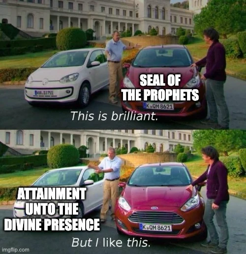
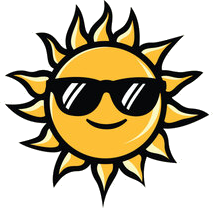
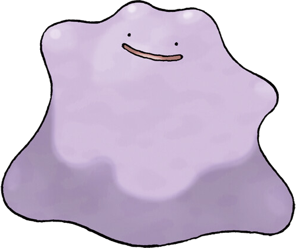
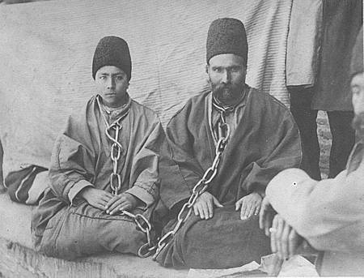
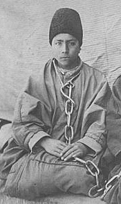

## Two themes this week

::: {.tiles .two .fill}
::: {.tile .marked}
[The Station of Pure Abstraction and Essential Unity]{.tile-name}
[Paragraphs 161–162]{.tile-epithet}

- The Manifestations of God are regarded as **one soul and the same person**
- They are all "**uttering the same speech, and proclaiming the same Faith**"
- The foundation of **progressive revelation**
:::

::: {.tile .marked}
[The Return of the Prophets and Their Companions]{.tile-name}
[Paragraphs 157–188]{.tile-epithet}

- **The Divine Elixir and the transformation of the early believers**: souls transmuted "swift as the twinkling of an eye"
- **The First and the Last**: each Manifestation is both, for all proclaim one and the same Cause
:::
:::

---

## Seal of the Prophets and Attaining the Divine Presence

::: {.figure-slide .meme-slide}
::: {.incremental .fill}
- Bahá'u'lláh acknowledges that Muḥammad is the Seal of the Prophets
- But He also points out that the Qur'án promises many, many times that we will meet God
- Last week we established that meeting God can only mean meeting the Manifestation
- In the whole Qur'án, the Seal of the Prophets is mentioned one time
- The promise of meeting God is mentioned [at least 29 times](../presence.qmd)!
- Even the [verse about the Seal of the Prophets](https://quran.com/al-ahzab/40?translations=95)
  is followed, four verses later, by a promise of meeting God (33:44)
:::

::: {.meme .fragment}
{fig-alt="A two-panel meme. A man calls a car labelled 'Seal of the Prophets' brilliant, then points to a car labelled 'Attainment unto the Divine Presence' and says 'But I like this'."}
:::
:::

---

## The Concept of Return

::: {.slide-sub}
Why would a Prophet say they are the last?
:::

::: {.fs-body .fs-lg}
::: {.fragment}
**First doctor:** "You have a cold. It's a virus, so antibiotics won't help. Rest, drink plenty of
fluids, and don't take antibiotics."
:::

::: {.fragment}
*A week later you are worse: a high fever, a bad cough, and pain in your chest.*
:::

::: {.fragment}
**Second doctor:** "This has become a chest infection. You need antibiotics now."
:::

::: {.fragment}
**You:** "But the first doctor told me not to take antibiotics. I'll keep following their advice."
:::

::: {.fragment}
**Second doctor:** "That advice was right for the illness you had then. Your condition has changed.
I am the last doctor you have seen."
:::

::: {.fragment}
*The second doctor might also say:*
:::

::: {.fragment}
**Second doctor:** "We are both doctors! If the first doctor were here now, they would give you the
same advice."
:::

::: {.fragment}
**Second doctor:** "I am the first doctor! And I am telling you to take the antibiotics."
:::
:::

---

## The Concept of Return

::: {.slide-sub}
Why else would a Prophet say they are the last?
:::

::: {.fs-body .fs-lg}
::: {.fragment}
*At a wedding, the bridesmaids walk down the aisle one after another.*
:::

::: {.fragment}
**Guest** *(whispering)*: "Are there more bridesmaids coming?"
:::

::: {.fragment}
**Last bridesmaid:** "No, I'm the last one."
:::

::: {.fragment}
**Guest:** "Oh, so that's the end?"
:::

::: {.fragment}
**Last bridesmaid:** "The end of the bridesmaids. Whoever comes after me isn't a bridesmaid at all.
Stand up, here comes the bride!"
:::
:::

---

## The Concept of Return

::: {.slide-sub}
Consider the sun
:::

::: {.sun-stage}
::: {.sun-day}
::: {.day-label}
Wednesday
:::

::: {.cast-row}
::: {.cast}
::: {.bubble .fragment}
Hey guys
:::

{.cast-img fig-alt="A cartoon sun wearing sunglasses."}
:::
:::
:::

::: {.sun-day}
::: {.day-label}
Thursday
:::

::: {.cast-row}
::: {.cast}
::: {.bubble-stack}
::: {.bubble .fragment .fade-in-then-out}
I am the sun of yesterday
:::

::: {.bubble .fragment .fade-in-then-out}
I am a different sun, the sun of today
:::

::: {.bubble .fragment .fade-in-then-out}
I am the first sun
:::

::: {.bubble .fragment}
I am the last sun
:::
:::

{.cast-img fig-alt="A cartoon sun wearing sunglasses."}
:::
:::
:::
:::

::: {.tiny .cast-cite}
Kitáb-i-Íqán ¶20
:::

---

## The Concept of Return

::: {.slide-sub}
One after another
:::

::: {.conveyor}
::: {.cast-row}
::: {.cast .fragment .fade-left fragment-index=0}
::: {.bubble .fragment .fade-out fragment-index=1}
I am the last
:::

{.cast-img fig-alt="Ditto, a smiling purple blob."}
:::

::: {.cast .fragment .fade-left fragment-index=1}
::: {.bubble .fragment .fade-out fragment-index=2}
I am the last
:::

{.cast-img fig-alt="Ditto, a smiling purple blob."}
:::

::: {.cast .fragment .fade-left fragment-index=2}
::: {.bubble}
I am the first and the last
:::

{.cast-img fig-alt="Ditto, a smiling purple blob."}
:::
:::

::: {.belt}
:::
:::

::: {.tiny .cast-cite}
Kitáb-i-Íqán ¶172 and ¶196
:::

---

## The Concept of Return

::: {.slide-sub}
Further reading
:::

::: {.reading-list}
::: {.reading-card}
::: {.rc-head}
[Pre-existence and Origination]{.rc-title}
[ʻAbdu'l-Bahá, *Some Answered Questions*]{.rc-source}
[Read the chapter →](https://www.bahai.org/r/819040357){.rc-link}
:::

::: {.rc-text}
Thus it is clear and evident that although created things exist, in relation to God and to His Word
they are non-existent. This is the firstness and the lastness of the Word of God, Who says, "I am
the Alpha and the Omega", for He is both the source of grace and its ultimate goal.
:::
:::

::: {.reading-card}
::: {.rc-head}
[The Extent and Limitation of Human Comprehension]{.rc-title}
[ʻAbdu'l-Bahá, *Some Answered Questions*]{.rc-source}
[Read the chapter →](https://www.bahai.org/r/898070623){.rc-link}
:::

::: {.rc-text}
That is why Christ said: "I am Alpha and Omega, the first and the last"—that is, there has never
been, nor shall there ever be, any change or alteration in Me.
:::
:::

::: {.reading-card}
::: {.rc-head}
[The Three Stations of the Divine Manifestations]{.rc-title}
[ʻAbdu'l-Bahá, *Some Answered Questions*]{.rc-source}
[Read the chapter →](https://www.bahai.org/r/370649857){.rc-link}
:::

::: {.rc-text}
The third station is that of divine manifestation and heavenly splendour, which is the Word of God,
the everlasting Grace, and the Holy Spirit. This station has neither beginning nor end; for
firstness and lastness pertain to the contingent world and not to the world of God. For God the
beginning and the end are one and the same.
:::
:::
:::

---

## The Concept of Return

::: {.slide-sub}
He Who will come after Me
:::

::: {.fs-body .fs-md .bold-quotes}
::: {.fragment}
"I am not apprehensive for My own self," Bahá'u'lláh still more explicitly declares, "My fears
are for Him Who will be sent down unto you after Me—Him Who will be invested with great
sovereignty and mighty dominion." And again He writes in the Súratu'l-Haykal: "By those words
which I have revealed, Myself is not intended, but rather He Who will come after Me. To it is
witness God, the All-Knowing." "Deal not with Him," He adds, "as ye have dealt with Me."

[Shoghi Effendi, *The World Order of Bahá'u'lláh*, p. 117]{.attrib}
:::

::: {.fragment}
As to the meaning of the quotation, "My fears are for Him Who will be sent down unto you after
Me," this refers to the Manifestation who is to come after a thousand or more years, who like
all previous Messengers of God will be subjected to persecutions, but will eventually triumph
over them. For men of ill-will have been and will always continue to be in this world, unless
mankind reaches a state of complete and absolute perfection—a condition which is not only
improbable but actually impossible to attain. The fundamental difference, however, between this
Dispensation and all previous ones is this, that in this Revelation the possibility of permanent
schism between the followers of the Prophet has been prevented through the direct and explicit
instructions providing for the necessary instruments designed to maintain the organic unity of
the body of the Faithful.

[Shoghi Effendi, *Directives from the Guardian*, no. 112]{.attrib}
:::
:::

---

## Story Corner

::: {.slide-sub}
Rúhu'lláh
:::

::: {.figure-slide .story-lg}
::: {.fs-body .fs-prose}
::: {.fragment}
Varqá's two children ʻAzízu'lláh and Rúhu'lláh who accompanied him to ʻAkká also had the honour of
attaining the presence of Bahá'u'lláh several times. Contact with the Supreme Manifestation of God
left an abiding impression on their souls. Though young in age they both became charged with the
spirit of faith.
:::

::: {.fragment}
Rúhu'lláh in particular flourished spiritually in those holy surroundings. He may be regarded as one
of the spiritual prodigies which the hand of God has raised up in this Dispensation. Although he was
only about eight years old when he came into the presence of Bahá'u'lláh, his understanding of the
Faith was very profound.
:::

::: {.tiny}
Adib Taherzadeh, *The Revelation of Bahá'u'lláh*, vol. 4.
:::
:::

::: {.fs-portrait}

:::
:::

---

## Story Corner

::: {.slide-sub}
Rúhu'lláh
:::

::: {.figure-slide .story-md}
::: {.fs-body .fs-prose}
::: {.fragment}
To cite one example: One day Bahá'u'lláh asked Rúhu'lláh, 'What did you do today?'
:::

::: {.fragment}
He replied, 'I was having lessons from — [a certain teacher].'
:::

::: {.fragment}
Bahá'u'lláh asked, 'What subject were you learning?'
:::

::: {.fragment}
'Concerning the return [of the prophets]', said Rúhu'lláh.
:::

::: {.fragment}
'Will you explain what this means?' Bahá'u'lláh demanded.
:::

::: {.fragment}
He replied: 'By return is meant the return of realities and qualities.'
:::

::: {.fragment}
Bahá'u'lláh, questioning him further, said: 'These are exactly the words of your teacher and you are
repeating them like a parrot. Tell me in your own words your own understanding of the subject.'
:::

::: {.fragment}
'It is like cutting a flower from a plant this year,' answered Rúhu'lláh. 'Next year's flower will
look exactly like this one, but it is not the same.'
:::

::: {.fragment}
The Blessed Beauty praised the child for his intelligent answer and often called him
Jináb-i-Muballigh (His honour, the Bahá'í teacher).
:::

::: {.tiny}
Adib Taherzadeh, *The Revelation of Bahá'u'lláh*, vol. 4.
:::
:::

::: {.fs-portrait}

:::
:::

---

## Story Corner

::: {.slide-sub}
Rúhu'lláh
:::

::: {.figure-slide .story-md}
::: {.fs-body .fs-prose}
::: {.fragment}
One day the Greatest Holy Leaf noticed that Rúhu'lláh (9 years old) and his older brother ʻAzízu'lláh were playing
in the garden. She called them in and they sat in her presence. Also present were Mírzá Badíʻu'lláh
and Mírzá Díyá'u'lláh, the two sons of Bahá'u'lláh who later joined hands with Mírzá Muḥammad-ʻAlí
the Arch-breaker of the Covenant of Bahá'u'lláh. The Greatest Holy Leaf, often referred to as
'Khánum', asked them what they said to people when teaching the Faith.
:::

::: {.fragment}
'We tell them', Rúhu'lláh answered, 'that God has manifested Himself.'
:::

::: {.fragment}
Surprised at this remark, Khánum told them that surely they could not say such a thing straight
away to people!
:::

::: {.fragment}
'We don't tell this to everybody,' responded Rúhu'lláh, 'we only say it to those who have the
capacity to hear such a statement.'
:::

::: {.fragment}
'How would you know such people?' asked Khánum.
:::

::: {.fragment}
'We look into their eyes and then know whether we can give them the Message,' replied Rúhu'lláh.
:::

::: {.tiny}
Adib Taherzadeh, *The Revelation of Bahá'u'lláh*, vol. 4.
:::
:::

::: {.fs-portrait}

:::
:::

---

## Story Corner

::: {.slide-sub}
Rúhu'lláh
:::

::: {.figure-slide}
::: {.fs-body .fs-prose}
::: {.fragment}
Once Rúhu'lláh (10–12 years old) and his older brother were walking in town. A Muslim clergyman riding on his donkey
spotted the two boys and from their appearance he knew they were strangers in Zanján. So he went to
them and said, 'Who are you?'
:::

::: {.fragment}
Rúhu'lláh answered, 'We are sons of Varqá, a native of Yazd.'
:::

::: {.fragment}
'What is your name?' the clergyman demanded.
:::

::: {.fragment}
'My name is Rúhu'lláh,' came the answer.
:::

::: {.fragment}
'That is a great name,' said the clergyman. 'Christ was Rúhu'lláh and He used to raise the dead and
give them life.'
:::

::: {.fragment}
'Sir, if you slow down the pace of your donkey,' Rúhu'lláh declared with great enthusiasm, 'I too
shall raise you from the dead and give you a new life!'
:::

::: {.fragment}
The clergyman hurriedly left saying, 'You two must be Bábí children!'
:::

::: {.tiny}
Rúhu'lláh means "the Spirit of God", a title given to Christ in the Qur'án. Adib Taherzadeh,
*The Revelation of Bahá'u'lláh*, vol. 4.
:::
:::

::: {.fs-portrait}

:::
:::
