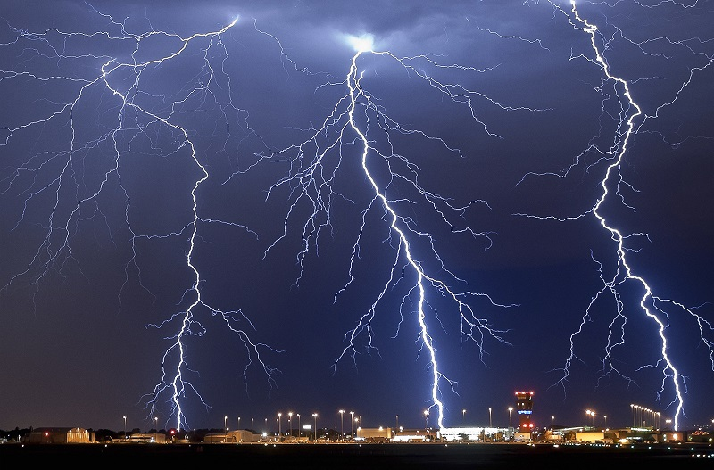
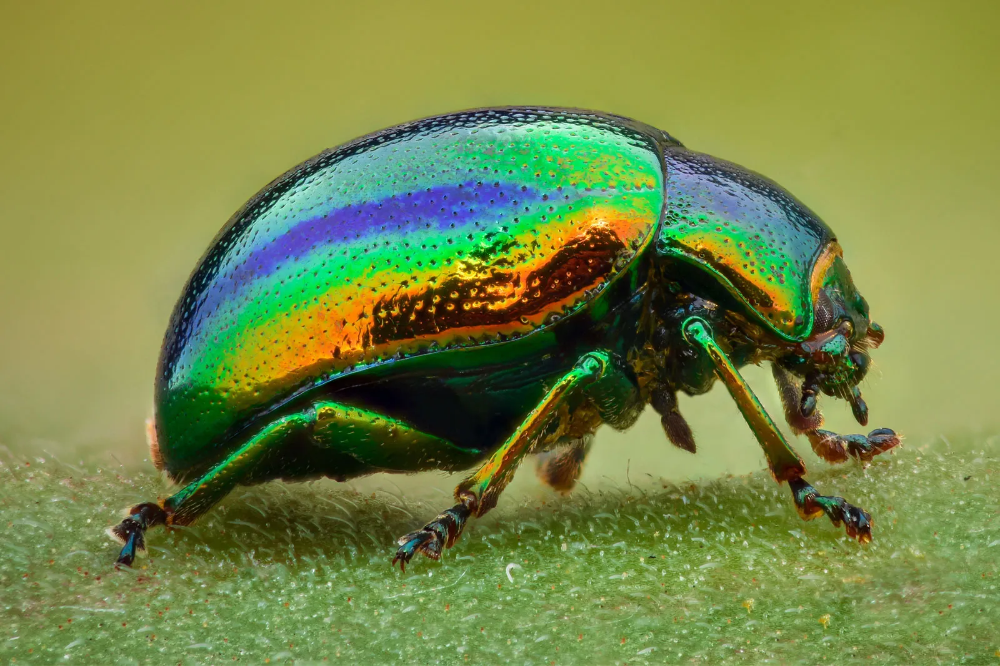
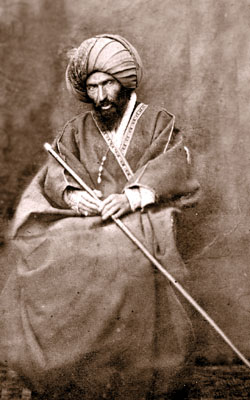

##  {.divider}

::: {.kicker}
Week 9
:::
::: {.divider-title}
Paragraphs 189–212
:::

---

## Reflections or questions

::: {.incremental}
- What stood out to you in this section?
- Any questions about the passages?
- Were there any words, phrases, or concepts you didn't understand?
:::

---

##  {.divider}

::: {.kicker}
Quiz · Round 1
:::
::: {.divider-title}
Metaphor, or just nature?
:::
::: {.divider-sub}
You will see a word from nature. Write down whether Bahá'u'lláh uses it as a metaphor in the Íqán, or whether it is just part of nature.
:::
::: {.divider-sub}
Bonus point: if it is a metaphor, say how Bahá'u'lláh uses it.
:::

---

## Question 1

::: {.slide-sub}
Metaphor, or just nature?
:::

:::: {.columns}
::: {.column width="45%"}
**Thunder**

::: {.fragment}
**Just nature.** The word *thunder* never appears in the Íqán.
:::
:::
::: {.column width="55%"}

:::
::::

---

## Question 2

::: {.slide-sub}
Metaphor, or just nature?
:::

:::: {.columns}
::: {.column width="45%"}
**Beetle**

::: {.fragment}
**Metaphor.** "So great are the overflowings of Its bounty that the foulest beetle hath sought the perfume of the musk, and the bat the light of the sun."

[Kitáb-i-Íqán, ¶64]{.attrib}
:::
:::
::: {.column width="55%"}

:::
::::

---

## Question 3

::: {.slide-sub}
Metaphor, or just nature?
:::

:::: {.columns}
::: {.column width="45%"}
**Winter**

::: {.fragment}
**Just nature.** *Winter* never appears, though *springtime* does: "Seize the time, therefore, ere the glory of the divine springtime hath spent itself…"

[Kitáb-i-Íqán, ¶23]{.attrib}
:::
:::
::: {.column width="55%"}

:::
::::

---

##  {.divider}

::: {.kicker}
Quiz · Round 2
:::
::: {.divider-title}
Book of Certitude, or just AI?
:::
::: {.divider-sub}
You will see a sentence. Write down whether it is from the Book of Certitude or was written by AI.
:::
::: {.divider-sub}
Bonus point: if it is from the book, name the paragraph (+/- 5 is accepted).
:::

---

## Question 1

::: {.slide-sub}
Book of Certitude, or just AI?
:::

**If thou wilt observe with discriminating eyes, thou wilt behold them all abiding in the same tabernacle, soaring in the same heaven, seated upon the same throne, uttering the same speech, and proclaiming the same Faith.**

::: {.fragment}
**Book of Certitude.** On the unity of the Manifestations of God.

[Kitáb-i-Íqán, ¶162]{.attrib}
:::

---

## Question 2

::: {.slide-sub}
Book of Certitude, or just AI?
:::

**Even as the night of heedlessness giveth way unto the day of the Lord, so are the hearts of the faithful clad anew in the raiment of His bounty.**

::: {.fragment}
**AI.** It's close to the Íqán's imagery of night and the Day of God, but these words don't appear in the book.
:::

---

## Question 3

::: {.slide-sub}
Book of Certitude, or just AI?
:::

**Leaders of religion, in every age, have hindered their people from attaining the shores of eternal salvation, inasmuch as they held the reins of authority in their mighty grasp.**

::: {.fragment}
**Book of Certitude.** On why the people denied the Prophets of God.

[Kitáb-i-Íqán, ¶15]{.attrib}
:::

---

##  {.divider}

::: {.kicker}
Quiz · Round 3
:::
::: {.divider-title}
Emoji Íqán
:::
::: {.divider-sub}
You will see a row of emojis. Write down the passage or concept from the Íqán they stand for.
:::
::: {.divider-sub}
Bonus point: give the exact quotation.
:::

---

## Question 1

::: {.slide-sub}
Emoji Íqán
:::

[☀️⬛️ 🌙🚫💡 ⭐️⬇️]{style="font-size: 2.4em; letter-spacing: 0.08em;"}

::: {.fragment}
**The signs of the Return.** "Immediately after the oppression of those days shall the sun be darkened, and the moon shall not give her light, and the stars shall fall from heaven…"

[Kitáb-i-Íqán, ¶24, quoting Matthew 24:29]{.attrib}
:::

---

## Question 2

::: {.slide-sub}
Emoji Íqán
:::

[🕍🧎 &nbsp;➡️ 🕋 😱]{style="font-size: 2.4em; letter-spacing: 0.08em;"}

::: {.fragment}
**The changing of the Qiblih.** "In the midst of that same prayer, Muḥammad suddenly turned His face away from Jerusalem and faced the Ka‘bih. … Verily, God caused not this turmoil but to test and prove His servants."

[Kitáb-i-Íqán, ¶54]{.attrib}
:::

---

## Question 3

::: {.slide-sub}
Emoji Íqán
:::

[🌅 🌹 🟰 🌹 🌇]{style="font-size: 2.4em; letter-spacing: 0.08em;"}

::: {.fragment}
**The unity of the Prophets.** "Consider the rose: whether it blossometh in the East or in the West, it is nonetheless a rose."

[Kitáb-i-Íqán, ¶169]{.attrib}
:::

---

## A Certain Man

> "For instance, a certain man, reputed for his learning and attainments, and accounting himself as one of the preeminent leaders of his people, hath in his book denounced and vilified all the exponents of true learning."
>
> [Kitáb-i-Íqán, ¶203]{.attrib}

::: {.figure-slide}
::: {.fs-portrait .fragment style="order: 2; flex-basis: 190px;"}
{fig-alt="Portrait of Ḥájí Mírzá Karím Khán-i-Kirmání"}
:::

::: {.fs-body .incremental}
- **Ḥájí Mírzá Karím Khán-i-Kirmání** was a disciple of Shaykh Aḥmad and Siyyid Káẓim, like Mullá Ḥusayn and many early believers. Their followers were known as **Shaykhís**
- Siyyid Káẓim appointed no successor, but urged his disciples to scatter and search for the Promised One. Mullá Ḥusayn obeyed, and found the Báb in Shíráz
- Karím Khán stayed in Kirmán and claimed the leadership of the Shaykhís. Siyyid Káẓim had foreseen it, calling him "the antichrist of the promised Revelation"
- He added a **Fourth Pillar** to the three pillars of the faith (God, Muḥammad and the Imáms), and later claimed to be it, until the clergy forced him to withdraw
- The Báb summoned him to the Cause. He refused, and wrote treatises against the Báb, including *The Crushing of Falsehood*
:::
:::

---

## The Most Great Roasting {.smaller}

:::: {.columns}
::: {.column width="48%"}
::: {.incremental}
- "A certain man informed Us that one of his compositions, entitled *Irshádu'l-'Avám* (Guidance unto the ignorant), could be found in this city."
- "From this title We perceived the odor of conceit and vainglory, inasmuch as he hath imagined himself a learned man and regarded the rest of the people ignorant."
- "It was probably referred to twice. The second time, We accidentally came upon the story of the 'Mi'ráj' (Ascent) of Muḥammad."
- "We noticed that he had enumerated some twenty or more sciences, the knowledge of which he considered to be essential for the comprehension of the mystery of the 'Mi'ráj.'"
- "Among the specified sciences were the science of metaphysical abstractions, of alchemy, and natural magic."
:::
:::

::: {.column width="4%"}
:::

::: {.column width="48%"}
::: {.incremental}
- "Such vain and discarded learnings, this man hath regarded as the prerequisites of the understanding of the sacred and abiding mysteries of divine Knowledge."
- "How clear and evident it is to every discerning heart that this so-called learning is and hath ever been rejected by Him Who is the one true God."
- "How can the knowledge of these sciences … be regarded as essential to the apprehension of the mysteries of the 'Mi'ráj,' whilst the Lord of the 'Mi'ráj' Himself was never burdened with a single letter of these limited and obscure learnings?"
- "We were surprised exceedingly when We observed that his one purpose was to make the people realize that all these learnings were possessed by him."
- "And yet, I swear by God that not one breath, blowing from the meads of divine knowledge, hath ever been wafted upon his soul."
:::
:::
::::

[Kitáb-i-Íqán, ¶203–206]{.attrib}

---

## The Scar of Chains

> Among the sciences which this pretender hath professed is that of alchemy. We cherish the hope that either a king or a man of preeminent power may call upon him to translate this science from the realm of fancy to the domain of fact and from the plane of mere pretension to that of actual achievement. Would that this unlearned and humble Servant, who never laid any pretension to such things, nor even regarded them as the criterion of true knowledge, might undertake the same task, that thereby the truth might be known and distinguished from falsehood. But of what avail! All this generation could offer Us were wounds from its darts, and the only cup it proffered to Our lips was the cup of its venom. On Our neck We still bear the scar of chains, and upon Our body are imprinted the evidences of an unyielding cruelty.
>
> [Kitáb-i-Íqán, [¶208](../read.qmd#p208)]{.attrib}

For the story behind these words, see the [timeline of Bahá'u'lláh's sufferings](../sufferings.qmd).
