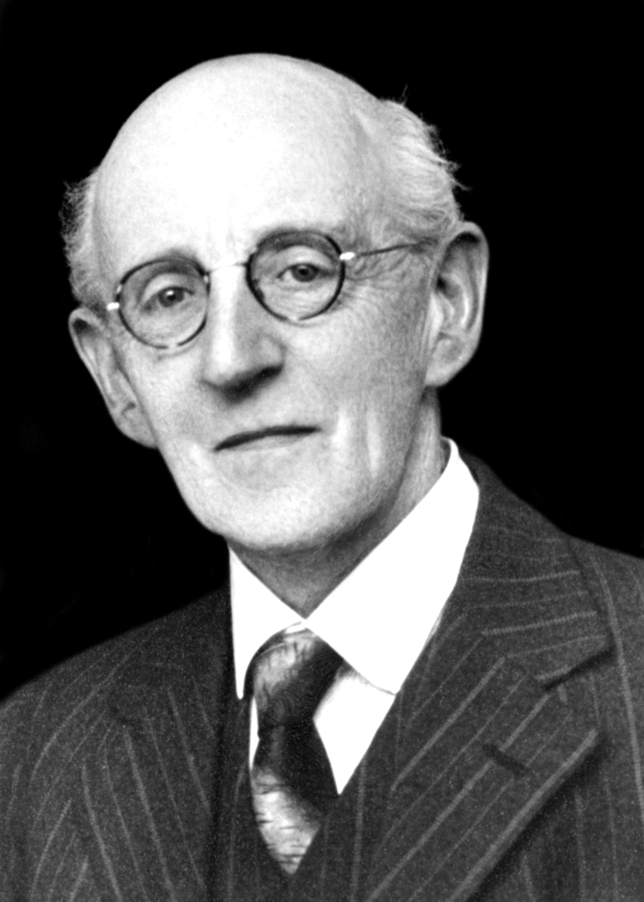
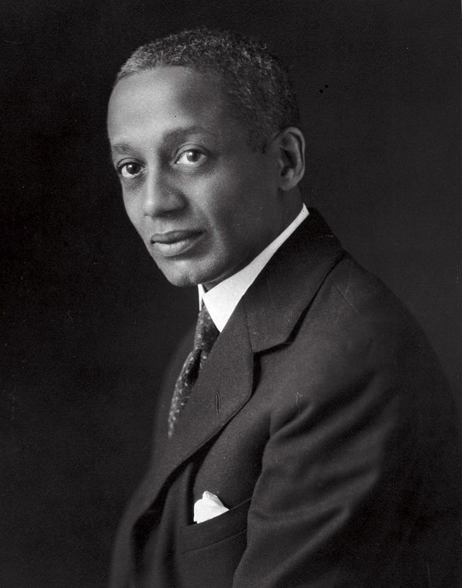
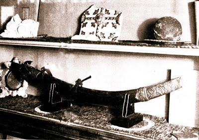
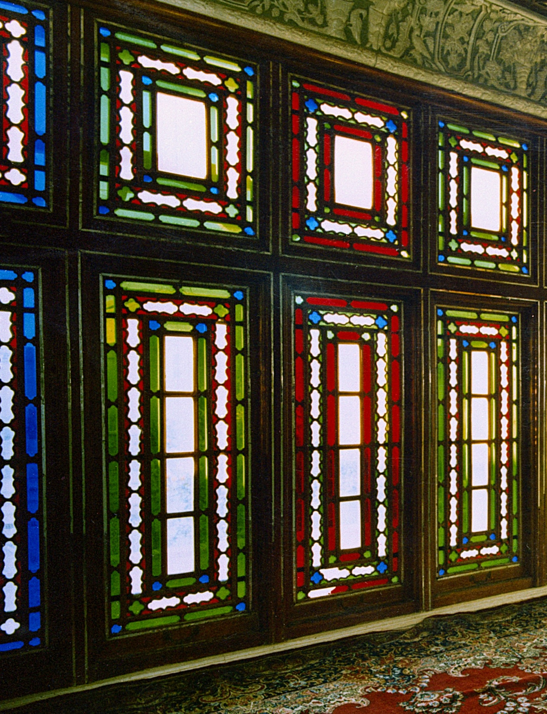

##  {.divider}

::: {.kicker}
Week 10
:::
::: {.divider-title}
Paragraphs 213–245
:::

---

## Reflections or questions

::: {.incremental}
- What stood out to you in this section?
- Any questions about the passages?
- Were there any words, phrases, or concepts you didn't understand?
:::

---

## Foreword

::: {.figure-slide}
::: {.fs-body style="font-size: 0.95em;"}
> This is one more attempt to introduce to the West, in language however inadequate, this book of
> unsurpassed preeminence among the writings of the Author of the Bahá'í Revelation. The hope is
> that it may assist others in their efforts to approach what must always be regarded as the
> unattainable goal—a befitting rendering of Bahá'u'lláh's matchless utterance.
>
> [Shoghi Effendi, Foreword to *The Kitáb-i-Íqán* (1931)]{.attrib}
:::

::: {.fs-portrait style="flex-basis: 290px;"}
{fig-alt="Shoghi Effendi as a young man, in a belted overcoat and striped tie."}
:::
:::

---

## Help with the English

::: {.slide-sub}
Shoghi Effendi asks the West for assistance
:::

::: {.figure-slide}
::: {.fs-body .incremental}
- Shoghi Effendi made the translation himself, but did not want a word-for-word rendering. He wanted the English to read as living English
- So he sent his drafts to Western believers and asked for their criticism and suggestions
- Among them were **George Townshend**, an Irish clergyman and writer, and **Alain LeRoy Locke**, a philosopher at Howard University
:::

::: {.fs-portrait style="flex-basis: 430px;"}
::: {.portrait-pair}
::: {}
{fig-alt="George Townshend in later life, with round spectacles and a pinstriped suit."}
[George Townshend]{.pp-name .fragment fragment-index=0}
:::

::: {}
{fig-alt="Alain Locke, in a dark suit, looking over his shoulder."}
[Alain LeRoy Locke]{.pp-name .fragment fragment-index=0}
:::
:::
:::
:::

---

## Alain LeRoy Locke

::: {.slide-sub}
1885–1954
:::

::: {.figure-slide}
::: {.fs-body .incremental}
- Born in Philadelphia 
- The only child of Pliny Ishmael Locke and Mary Hawkins Locke, who were both teachers
- Graduated from Harvard in 1907, and that year became the first African American Rhodes Scholar, studying at Oxford and then in Berlin
- Completed a PhD in philosophy at Harvard in 1918. 
- Became a Bahá'í in 1918 in Washington, D.C., made pilgrimage to Haifa in 1923 and 1924, and wrote on race unity for *The Bahá'í World*
- His thesis was about the theory of value: how people come to see things as good, beautiful or true
- He introduced the idea of **cultural pluralism**: that values grow out of human experience and culture, so no one people's values are the measure of all others
- Taught philosophy at Howard University for nearly forty years
:::

::: {.fs-portrait style="flex-basis: 250px;"}
{fig-alt="Alain Locke, in a dark suit, looking over his shoulder."}
:::
:::

---

## Alain LeRoy Locke

::: {.slide-sub}
*The New Negro* and the Harlem Renaissance
:::

::: {.figure-slide}
::: {.fs-body .incremental}
- He edited an anthology called _The New Negro_ in 1925, a collection of fiction, poetry, drama, essays and art, mostly by Black writers and artists. 
- Contributors included: W. E. B. Du Bois, Langston Hughes, Countee Cullen, Zora Neale Hurston, Jean Toomer, Claude McKay, and James Weldon Johnson, with art by Aaron Douglas and portraits by Winold Reiss
- This book started a movement which today is called the Harlem Renaissance, a movement which redefined what it meant to be a black person in America.
- Known as the **father, architect and dean of the Harlem Renaissance**
- M.L.K Jr. referred to him in 1968 saying: "We're going to let our children know that the only philosophers that lived were not Plato and Aristotle, but W. E. B. Du Bois and Alain Locke…" 
- He was gay and was a trusted confidant to other LGBT figures
:::

::: {.fs-portrait style="flex-basis: 250px;"}
{fig-alt="Alain Locke, in a dark suit, looking over his shoulder."}
:::
:::

---

##  {.divider}

::: {.kicker}
Haifa · 1930
:::
::: {.divider-title}
Letters to Alain Locke
:::
::: {.divider-sub}
Written on Shoghi Effendi's behalf by his secretary, Ruhi Afnan, while the Íqán was being translated
:::

---

## Letters to Alain Locke

::: {.slide-sub}
First letter · Persian Colony, Haifa · 15 February 1930
:::

::: {.figure-slide}
::: {.fs-body .fs-prose}
Dear Dr. Locke:

::: {.fragment}
Shoghi Effendi has been lately spending his leisure hours translating the Book of Iqan for he
considers it to be the key to a true understanding of the Holy Scriptures, & can easily rank as one
of the most, if not the most, important thing that Bahá'u'lláh revealed explaining the basic beliefs
of the Cause. **He who fully grasps the purport of that Book can claim to have understood the
Cause.**
:::

::: {.fragment}
Yet, Shoghi Effendi believes that mere translation into English phrases is not sufficient. It is
essential to make the idioms & expressions lively English, a thing which he alone cannot possibly
achieve. Thinking, therefore, that you will be the best fitted to render him an assistance along that
line, he is sending you the part that he has already completed. He would be most appreciative if you
go over it carefully, studying every sentence — its structure as well as choice of words — & giving
him your criticism as well as constructive suggestions that would make it more lucid, English &
forceful. **As it is a Holy Scripture, Shoghi Effendi has tried to put it in the English of the
Bible**, preferring its ways of expression better than any other.
:::
:::

::: {.fs-portrait style="flex-basis: 170px;"}
::: {.portrait-pair .stack}
::: {}
{fig-alt="Shoghi Effendi as a young man, in a belted overcoat and striped tie."}
[Shoghi Effendi]{.pp-name}
:::

::: {}
{fig-alt="Alain Locke, in a dark suit, looking over his shoulder."}
[Alain Locke]{.pp-name}
:::
:::
:::
:::

---

## Letters to Alain Locke

::: {.slide-sub}
First letter · continued
:::

::: {.figure-slide}
::: {.fs-body .fs-md}
::: {.fragment}
What he sends you now is half of the book, the rest he will mail as it is translated. The form that
it is in at present is far from being the last one. Yet he wishes to have all the possible
suggestions before he puts it in its final form.
:::

::: {.fragment}
Shoghi Effendi is fully aware of the many duties you have & how pressing your time is, & had he
known of an equally fitting person he would surely have saved you the trouble. Yet he finds himself
to be compelled. He hopes, therefore, that you will give this work your close attention. **If the
book is completed & rendered into a lucid & forceful language, the service it will render to the
Cause will surely repay all your endeavours.**
:::

::: {.fragment}
In many places you will see the same idea expressed in other words & inserted in paranthesis. You
can chose any of the two. In case you have any suggestions just mention in what page & line it is.
You need not send him back the copy after going over it, for he may desire to refer to them later.
He has enough copies here. Though he wishes you to give it all your attention he will be much
obliged if you take it up immediately.
:::

::: {.fragment}
With deepest appreciation, yours ever sincerely, 
Ruhi Afnan
:::
:::

::: {.fs-portrait style="flex-basis: 170px;"}
::: {.portrait-pair .stack}
::: {}
{fig-alt="Shoghi Effendi as a young man, in a belted overcoat and striped tie."}
[Shoghi Effendi]{.pp-name}
:::

::: {}
{fig-alt="Alain Locke, in a dark suit, looking over his shoulder."}
[Alain Locke]{.pp-name}
:::
:::
:::
:::

---

## Letters to Alain Locke

::: {.slide-sub}
Second letter · Persian Colony, Haifa · 5 July 1930
:::

::: {.figure-slide}
::: {.fs-body .fs-prose}
Dear Prof. Locke:

::: {.fragment}
Shoghi Effendi wishes me to acknowledge the receipt of your letter as well as the mss. of the Iqan
which you had so kindly gone over. Though they were not so many, he found the suggestions you gave
most helpful. **In translation work the greatest difficulty is to give the thought a lively English
expression. This is most difficult for the person who gets absorbed into the original form & is
charmed with its beauty.** Shoghi Effendi has already incorporated your suggestions & sent his
manuscript to the National Assembly for publication. It naturally depends upon that body & the
reviewing & publishing committees to decide whether it should come out immediately or not.
:::

::: {.fragment}
**The most important service that can now be rendered to the Cause is to put the writings of
Bahá'u'lláh in a form that would be presentable to the intellectual minds of the west.** Shoghi
Effendi's hope in this work has been to encourage others along this line.
:::

::: {.fragment}
In closing may I express Shoghi Effendi's best wishes for your health as well as for the services
you are rendering to the Cause.
:::
:::

::: {.fs-portrait style="flex-basis: 170px;"}
::: {.portrait-pair .stack}
::: {}
{fig-alt="Shoghi Effendi as a young man, in a belted overcoat and striped tie."}
[Shoghi Effendi]{.pp-name}
:::

::: {}
{fig-alt="Alain Locke, in a dark suit, looking over his shoulder."}
[Alain Locke]{.pp-name}
:::
:::
:::
:::

---

## Letters to Alain Locke

::: {.slide-sub}
Postscript in the Guardian's own hand · 5 July 1930
:::

::: {.figure-slide}
::: {.fs-body .fs-lg}
::: {.fragment}
I wish to add a few words expressing my deep appreciation of your valued suggestions in connexion
with the translation of the Iqan. I wish also to express the hope that you may be able to lend
increasing assistance to the work of the Cause, as I have always greatly admired your exceptional
abilities & capacity to render distinguished services to the Faith.
:::

::: {.fragment}
I grieve to hear of the weakness of your heart which I trust may through treatment be completely
restored. I often remember you in my prayers and ever cherish the hope of welcoming you again in
the Master's home.
:::

::: {.fragment}
Your true brother, 
Shoghi
:::
:::

::: {.fs-portrait style="flex-basis: 170px;"}
::: {.portrait-pair .stack}
::: {}
{fig-alt="Shoghi Effendi as a young man, in a belted overcoat and striped tie."}
[Shoghi Effendi]{.pp-name}
:::

::: {}
{fig-alt="Alain Locke, in a dark suit, looking over his shoulder."}
[Alain Locke]{.pp-name}
:::
:::
:::
:::

---

##  {.divider}

::: {.kicker}
The Twin Holy Birthdays
:::
::: {.divider-title}
The Báb and Bahá'u'lláh
:::
::: {.divider-sub}
They never met in person. Two accounts of how each received word of the other.
:::

---

## The Scroll

::: {.slide-sub}
Ṭihrán · 1844
:::

::: {.figure-slide .story-md .quoted}
::: {.fs-body .fs-prose}
::: {.fragment}
The Báb sent Mullá Ḥusayn, the first to believe in Him, to Ṭihrán. There he met Mullá
Muḥammad-i-Muʻallim, a teacher from Núr, who later told the story. Mullá Ḥusayn asked him whether
anyone in the family of the late Mírzá Buzurg-i-Núrí still upheld its high traditions.
:::

::: {.fragment}
> "Yea," I replied, "among his sons now living, one has distinguished Himself by the very traits
> which characterised His father. …" "What is His occupation?" he asked me. "He cheers the disconsolate and feeds the hungry," I replied. "What of
> His rank and position?" "He has none," I said, "apart from befriending the poor and the
> stranger." "What is His name?" "Ḥusayn-ʻAlí."
:::

::: {.fragment}
> The eagerness with which Mullá Ḥusayn questioned me, and the sense of delight with which he
> welcomed every particular I gave him, greatly surprised me. … "Will you," he said, "deliver into
> His hands a trust from me?" "Most assuredly," was my reply. He then gave me a scroll wrapped in a
> piece of cloth, and requested me to hand it to Him the next day at the hour of dawn.
:::

[Nabíl, *The Dawn-Breakers*, pp. 105–106]{.attrib}
:::

::: {.fs-portrait}
{fig-alt="Mullá Ḥusayn's sword, long and curved, displayed on two stands beneath a shelf of relics."}
:::
:::

---

## The Scroll

::: {.slide-sub}
Ṭihrán · 1844 · continued
:::

::: {.figure-slide .story-md .quoted}
::: {.fs-body .fs-prose}
::: {.fragment}
> I was ushered into His presence, and presented the scroll to Mírzá Músá, who laid it before
> Bahá'u'lláh. … Unfolding the scroll, He glanced at its contents and began to read aloud to us
> certain of its passages. I sat enraptured as I listened to the sound of His voice and the
> sweetness of its melody.
:::

::: {.fragment}
> He had read a page of the scroll when, turning to His brother, He said: "Músá, what have you to
> say? **Verily I say, whoso believes in the Qur'án and recognises its Divine origin, and yet
> hesitates, though it be for a moment, to admit that these soul-stirring words are endowed with
> the same regenerating power, has most assuredly erred in his judgment and has strayed far from
> the path of justice.**"
:::

[Nabíl, *The Dawn-Breakers*, p. 106]{.attrib}
:::

::: {.fs-portrait}
{fig-alt="Mullá Ḥusayn's sword, long and curved, displayed on two stands beneath a shelf of relics."}
:::
:::

---

## The Scroll

::: {.slide-sub}
Ṭihrán · 1844 · continued
:::

::: {.figure-slide .story-md .quoted}
::: {.fs-body .fs-prose}
::: {.fragment}
> He spoke no more. Dismissing me from His presence, He charged me to take to Mullá Ḥusayn, as a
> gift from Him, a loaf of Russian sugar and a package of tea, and to convey to him the expression
> of His appreciation and love.
:::

::: {.fragment}
> I arose and, filled with joy, hastened back to Mullá Ḥusayn, and delivered to him the gift and
> message of Bahá'u'lláh. … He started to his feet, received with bowed head the gift from my hand, and fervently kissed it.
> … I was amazed at the behaviour of Mullá Ḥusayn. What could be, I thought to myself, the nature
> of the bond that unites these two souls? What could have kindled so fervid a fellowship in their
> hearts?
:::

[Nabíl, *The Dawn-Breakers*, p. 107]{.attrib}
:::

::: {.fs-portrait}
{fig-alt="Mullá Ḥusayn's sword, long and curved, displayed on two stands beneath a shelf of relics."}
:::
:::

---

## The Letter

::: {.slide-sub}
Shíráz · October 1844
:::

::: {.figure-slide .story-md .quoted}
::: {.fs-body .fs-prose}
::: {.fragment}
Mullá Ḥusayn wrote to the Báb of all that had happened on his journey, including his experience
with Bahá'u'lláh. The letter reached the Báb one night in the month of Ramaḍán. His only companion
that night was Quddús. The Báb's maternal uncle was there, and later described what he saw.
:::

::: {.fragment}
> That night I saw such evidences of joy and gladness on the faces of the Báb and of Quddús as I am
> unable to describe. I often heard the Báb, in those days, exultingly repeat the words, **"How
> marvellous, how exceedingly marvellous, is that which has occurred between the months of Jamádi
> and Rajab!"**
:::

::: {.fragment}
> As He was reading the communication addressed to Him by Mullá Ḥusayn, He turned to Quddús and,
> showing him certain passages of that letter, explained the reason for His joyous expressions of
> surprise. I, for my part, remained completely unaware of the nature of that explanation.
:::

[Nabíl, *The Dawn-Breakers*, pp. 126–127]{.attrib}
:::

::: {.fs-portrait}
{fig-alt="Stained-glass windows in red, blue and green, in the House of the Báb in Shíráz."}
:::
:::

---

## The Letter

::: {.slide-sub}
Shíráz · October 1844 · continued
:::

::: {.figure-slide .story-md .quoted}
::: {.fs-body .fs-prose}
::: {.fragment}
Mírzá Aḥmad, who heard this from the uncle, later asked Mullá Ḥusayn himself what it meant.
:::

::: {.fragment}
> He smiled and said how well he remembered that between the months of Jamádi and Rajab he chanced
> to be in Ṭihrán. He gave no further explanation. … This was sufficient, however, to convince me
> that in the city of Ṭihrán there lay hidden a Mystery which, when revealed to the world, would
> bring unspeakable joy to the hearts of both the Báb and Quddús.
:::

::: {.fragment}
Nabíl explains what the letter meant to the Báb:

> The references in Mullá Ḥusayn's letter to Bahá'u'lláh's immediate response to the Divine
> Message … cheered and gladdened the Báb, and reinforced His confidence in the ultimate victory of
> His Cause. He felt assured that … **the Cause which He had revealed would live; would, under the
> direction of Bahá'u'lláh, continue to develop and flourish, and would yield eventually its
> choicest fruit.**
:::

[Nabíl, *The Dawn-Breakers*, pp. 127–128]{.attrib}
:::

::: {.fs-portrait}
{fig-alt="Stained-glass windows in red, blue and green, in the House of the Báb in Shíráz."}
:::
:::
