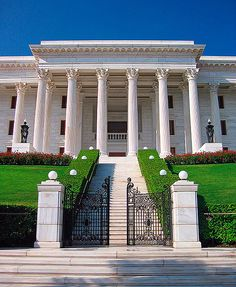
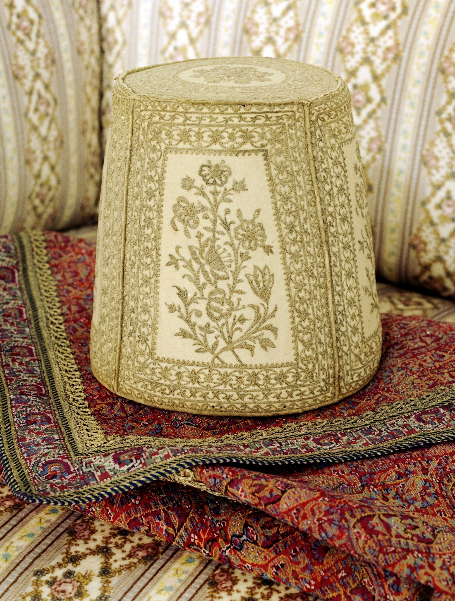

##  {.divider}

::: {.kicker}
Week 11
:::
::: {.divider-title}
Paragraphs 246–265
:::

---

## Reflections or questions

::: {.incremental}
- What stood out to you in this section?
- Any questions about the passages?
- Were there any words, phrases, or concepts you didn't understand?
:::

---

## The volume of the Writings

::: {.slide-sub}
Research Department of the Universal House of Justice
:::

::: {.figure-slide}
::: {.fs-body .fs-prose .fill}
::: {.fragment}
The Research Department has received a request from Mr. … in an email letter of 21 July 2010 for the latest statistics on the Sacred Writings available at the Bahá'í World Centre.
:::

::: {.fragment}
The collection and collation of the Sacred Writings is an ongoing process, and the numbers are continually being revised. While past statistics … were based on counting the number of originals, transcriptions, and drafts held in the Archives, and included an element of double counting, the collation work has now reached a stage where estimates of the numbers of unique works can be given, as follows:
:::

::: {.fragment}
For Bahá'u'lláh, well over 18,000 unique works have been identified, comprising over six million words. Of these works, nearly 15,000 have been authenticated by the Archives Office so far.
:::

::: {.fragment}
For the Báb, over 2,000 unique works have been identified, comprising almost five million words. The works of the Báb have not yet been formally authenticated.
:::

::: {.fragment}
For 'Abdu'l-Bahá, over 30,000 unique works have been identified, comprising over five million words. Of these works, over 27,000 have been authenticated by the Archives Office to date.
:::

::: {.fragment}
For Shoghi Effendi, well over 34,000 unique works have been identified, also comprising over five million words. Of these works, over 33,000 have been authenticated by the Archives Office.
:::

[Memorandum to the Universal House of Justice, [1 October 2010](https://bahai-library.com/uhj_numbers_sacred_writings)]{.poem-attrib .proof-attrib}
:::

::: {.fs-portrait}

:::
:::

---

## Proofs of the Báb's Revelation

::: {.slide-sub}
Themes for this week
:::

::: {.incremental}
- Learned people accepted the Message
- The exemplary and heroic deeds of the early believers
- The constancy of the Báb in proclaiming the Message
- The spiritual ascendancy of the Báb over the hearts of people
:::

::: {.notes}
Timing for a 90-minute session (scale to fit):

- 10 min: reflections and questions on the reading
- 5 min: frame the argument of ¶246–247
- 25 min: small groups read their person's card on the handout and answer question 1
- 20 min: each group introduces their person (about 5 min each)
- 15 min: whole-group discussion, handout questions 2 and 3

Ṭabarsí and Nayríz will come up, and someone may ask why the Bábís fought. Short answer:
in each case the Bábís were attacked and besieged by government troops and local mobs, and fought
to defend themselves; they did not wage offensive war. Shoghi Effendi treats these episodes as
defensive in *God Passes By*, and Bahá'u'lláh later abolished holy war altogether. Keep the focus
on what the Íqán uses these lives to show: learning, detachment and constancy.
:::

---

## The definition of martyrdom

::: {.slide-sub}
Bahá'u'lláh
:::

::: {.figure-slide}
::: {.fs-body .fs-prose .fill .fill-lg}
::: {.fragment}
Thou didst beg the Supreme Lord ... to bestow upon thee a station whereat in the path of His love
thou wouldst give up everything: thy life, thy spirit, thy reputation, thine existence, all in all.
All of these behests were submitted in the most sanctified, most exalted Presence of the Abhá
Beauty. Thus did the Tongue of the Merciful speak in the Kingdom of Utterance: “God willing, he shall
be seen in utmost purity and saintliness, as befitteth the Day of God, and attain the station of the
most great martyrdom. Today, the greatest of all deeds is service to the Cause. Souls that are well
assured should, with utmost discretion, teach the Faith, so that the sweet fragrances of the Divine
Garment will waft from all directions. This martyrdom is not confined to the destruction of life and
the shedding of blood. A person enjoying the bounty of life may yet be recorded a martyr in the Book
of the Sovereign Lord. Well is it with thee that thou hast wished to offer whatsoever is thine, and
all that is of thee and with thee in My path.”

[Bahá'u'lláh, quoted by 'Abdu'l-Bahá]{.poem-attrib .proof-attrib}
:::
:::

::: {.fs-portrait}

:::
:::

---

## The journeys of Mullá Ḥusayn

::: {.slide-sub}
Group 1
:::

```{=html}
<iframe src="https://www.google.com/maps/d/embed?mid=1AVYhP8S4cojtZxdy2I1T0W5oDDtY5Jxs&ehbc=2E312F&noprof=1"
        title="Map of Mullá Ḥusayn's journeys"
        style="width: 100%; height: 480px; border: 0;"
        allowfullscreen></iframe>
```

::: {.notes}
Leave this up while Group 1 presents. The map is live, so it needs an internet connection during the session, and it will not appear in
the PDF export of the slides.
:::
